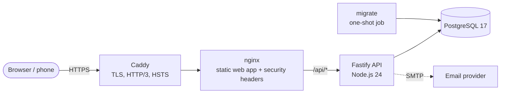
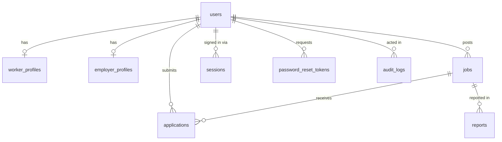

# Architecture

## System overview

- **Caddy** (production only) is the single public entry point. It obtains and renews Let's Encrypt certificates automatically.
- **nginx** serves the built single-page app with long-lived caching for fingerprinted assets, a strict Content-Security-Policy, and reverse-proxies `/api` to the API. Because the browser only ever talks to one origin, no CORS configuration is needed and cookies stay first-party.
- **API** is a stateless Fastify service, so you can run more than one copy. The exception is the rate limiter, which is in-memory per instance. See [Scaling](#scaling).
- **migrate** runs pending SQL migrations and exits. The API only starts once it succeeds.

## Code organisation

npm workspaces monorepo:

| Package           | Responsibility                                                                      |
| ----------------- | ----------------------------------------------------------------------------------- |
| `packages/shared` | Zod schemas, domain constants (states, categories, statuses) and API response types |
| `apps/api`        | HTTP API, database schema and migrations, operational CLI                           |
| `apps/web`        | React SPA                                                                           |

**Validation lives in one place.** Each input schema is in `packages/shared` and is used twice. The browser runs it for instant field-level feedback, and the API runs it as the authoritative check. The rules can't drift apart, and the API's `422` responses use the same `{ field: message }` shape the forms already display.

The API is bundled with esbuild into `dist/`, which inlines `@fwp/shared`. Third-party packages stay external and are installed in the runtime image with `--omit=dev`.

## Request lifecycle (API)

1. `onRequest`: **CSRF guard**. Any non-GET request must carry an `Origin` header equal to `APP_ORIGIN`.
2. `onRequest`: **session lookup**. The cookie token is SHA-256 hashed and looked up together with the user. Disabled users and expired sessions are rejected. Expiry slides forward at most once an hour.
3. **Rate limiting.** 300 requests/min per client IP overall, and 10/min on sign-in, registration and password endpoints.
4. **Handler.** `parse(schema, body)` validates the input, `requireRole()` authorises the caller, Drizzle runs the query, and `audit()` records security-relevant events.
5. **Error handler.** Every error becomes `{ error: { code, message, fields? } }`. Unexpected errors are logged with the request ID and returned as a generic 500.

## Data model

- Enumerated values (roles, categories, statuses) are PostgreSQL enums generated from the shared constants.
- Pay is stored as whole naira (`integer`) with a `pay_period` of day, week or month.
- `applications` has a unique `(job_id, worker_id)` key. Re-applying after a withdrawal reuses the same row (`ON CONFLICT … WHERE status = 'withdrawn'`).
- Deleting a user cascades to their profile, sessions, jobs and applications. Reports keep a null reporter, and audit entries keep a null actor.

## Key decisions

| Decision                                 | Why                                                                                                                                                        |
| ---------------------------------------- | ---------------------------------------------------------------------------------------------------------------------------------------------------------- |
| Server-side sessions, not JWTs           | Sessions can be revoked instantly (logout, password reset, account deletion). Only a hash of the token is stored, so a database leak can't be replayed.    |
| scrypt from Node's crypto                | A memory-hard hash with no native add-on to compile in Alpine images. Parameters are versioned in the hash, and weaker hashes are upgraded on login.       |
| `TRUST_PROXY` as a hop count             | The client IP (used for rate limits and audit) comes from the outermost trusted proxy. A spoofed `X-Forwarded-For` header can't change it.                 |
| Contact details hidden until shortlisted | This stops harvesting of workers' phone numbers, which is a known scam vector in informal labour markets.                                                  |
| Phone number as the main identity        | Many farm workers have no email address. The number is verified by SMS code at sign-up, so it's also a reliable way to reach them.                         |
| Notifications through an outbox table    | The SMS or email is written in the same transaction as the status change, then sent by a background loop with retries, so a provider outage loses nothing. |
| Same-origin deployment                   | No CORS, first-party `SameSite=Lax` cookies, and a simple CSP (`'self'`).                                                                                  |
| Plain CSS with design tokens             | No CSS framework to download. Every colour is a token with a light and a dark value, so dark mode is complete by construction.                             |
| Route-level code splitting               | Public browsing pages load first. Dashboards, admin and forms are fetched on demand, which matters on slow mobile data.                                    |

## Scaling

The current setup comfortably serves a national launch on one modest server (2 vCPU / 4 GB). When you outgrow it:

1. **Run several API instances.** Move rate-limit state into Redis (`@fastify/rate-limit` supports a `redis` option) so limits apply across all instances.
2. **Use a managed PostgreSQL** with point-in-time recovery. Point `DATABASE_URL` at it and drop the `db` service.
3. **Improve job search.** It currently uses indexed filters plus `ILIKE`. At tens of thousands of jobs, add a `tsvector` column with a GIN index, or a `pg_trgm` index.
4. **Use a CDN for static assets.** They are already fingerprinted and immutable.

## Roadmap ideas (not built)

- Emails in the recipient's preferred language (the interface is already translated; see TRANSLATIONS.md).
- WhatsApp as a notification channel (Termii supports it through `TERMII_CHANNEL=whatsapp`, but templates need approval first).
- Let employers choose how often they get new-applicant summaries (now fixed at most once a day).
- In-app messaging between employer and shortlisted worker.
- Upload the hidden source maps to Sentry in the release workflow, so browser stack traces show original code.
- Per-job preview images (title and pay drawn on the image) instead of one site-wide image.
